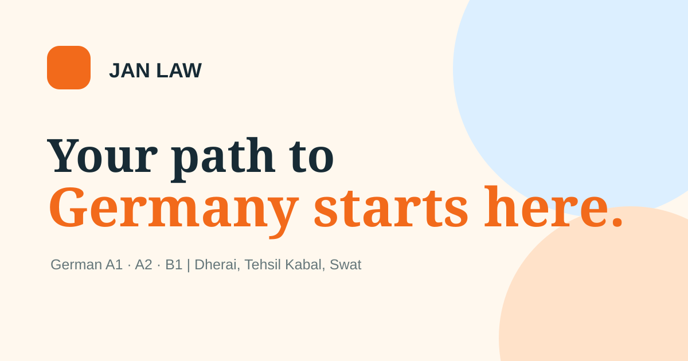

# Jan Law German Language Center

A responsive, public-facing website for a German language institute in Swat, Pakistan. The project brings together a polished front-end experience, clear course information, WhatsApp-based admission enquiries, search metadata and a maintainable static-site codebase.

<p align="center">
  
</p>

<p align="center">
  <a href="https://muneebinu.github.io/jan-law-german-language-center/">Live website</a>
  ·
  <a href="https://github.com/muneebinu/jan-law-german-language-center">Source code</a>
</p>

<p align="center">
  
  
  
  
  <a href="https://github.com/muneebinu/jan-law-german-language-center/actions/workflows/quality.yml">
    
  </a>
</p>

## Project overview

**Project:** Jan Law German Language Center website  
**Project owner and maintainer:** Muneeb Ur Rehman  
**Business:** Jan Law German Language Center, Jan Law Students Consultant Ltd  
**Location:** Dherai, Tehsil Kabal, Swat, Khyber Pakhtunkhwa, Pakistan  
**Landmark:** Next to Zubair Hospital, opposite Dherai Ground  
**Live URL:** [muneebinu.github.io/jan-law-german-language-center](https://muneebinu.github.io/jan-law-german-language-center/)

This is a real-world website project built to present the institute, explain its German course offerings and make it straightforward for prospective students to enquire about admission.

## Features

- Responsive layouts for desktop, tablet and mobile screens.
- Dedicated sections for the institute, courses, learning approach, instructor, admissions, FAQs, location and contact.
- Course information and fee presentation for German A1, A2 and B1.
- Admission enquiry form with client-side validation and a WhatsApp handoff.
- Separate office and instructor WhatsApp contact routes.
- Mobile navigation with keyboard dismissal support.
- Scroll-reveal interactions with a reduced-motion fallback.
- Search metadata, canonical URL, Open Graph metadata and structured data.
- Custom favicon, web app manifest, sitemap, robots file and not-found page.
- No front-end framework or runtime package dependencies.

## Technology

| Technology | Responsibility |
|---|---|
| HTML5 | Semantic page structure, content and SEO metadata |
| CSS3 | Design tokens, typography, layout, responsive behaviour and motion |
| Vanilla JavaScript | Navigation, form validation and WhatsApp interaction |
| Node.js built-in test runner | Automated source and content checks |
| GitHub Actions | Run quality checks on pushes and pull requests |
| GitHub Pages | Static website hosting and deployment |

The site is intentionally framework-free. It uses browser-native capabilities and has no build step.

## Repository structure

```text
.
├── .github/
│   └── workflows/
│       └── quality.yml       # Automated GitHub Actions checks
├── assets/
│   ├── css/
│   │   └── site.css          # Main design system and responsive styles
│   ├── js/
│   │   └── site.js           # Navigation, form and page interactions
│   ├── favicon.svg
│   ├── JAN LAW Education Logo.png  # Primary website logo and favicon
│   ├── muneeb.jpg                   # Self-hosted instructor profile photo
│   ├── jan-law-logo.svg             # Legacy vector mark
│   ├── jan-law-original-logo.b64    # Legacy logo asset
│   └── og-image.svg
├── tests/
│   └── site.test.mjs         # Automated website checks
├── 404.html                  # Custom not-found page
├── AGENTS.md                 # Project-specific implementation guidance
├── CONTRIBUTING.md           # Contribution and maintenance standards
├── DESIGN-SKILLS.md           # Design resources and their integration status
├── index.html                # Main page and structured data
├── package.json              # Dependency-free development scripts
├── robots.txt
├── sitemap.xml
├── site.webmanifest
└── README.md
```

### Separation of concerns

The project keeps its main responsibilities separate:

- **Content and SEO:** `index.html`
- **Visual design and responsive styling:** `assets/css/site.css`
- **Browser behaviour and form interactions:** `assets/js/site.js`
- **Automated checks:** `tests/site.test.mjs`
- **Continuous integration:** `.github/workflows/quality.yml`

The application script is loaded with `defer`. Structured data stays in the HTML so it can be read by search engines without relying on JavaScript.

## Run locally

You can preview the static website using any local web server.

### Option 1: Python

```bash
python -m http.server 8000
```

Open [http://localhost:8000](http://localhost:8000).

### Option 2: Node.js

Use any static file server available in your development environment. No framework installation or compilation is required.

## Quality checks

Node.js 18 or newer is required for the automated checks. The project uses Node's built-in test runner and does not require installing third-party packages.

Run the full check:

```bash
npm run check
```

Run the tests only:

```bash
npm test
```

The current test suite checks:

- Essential HTML metadata and document structure.
- Separation of HTML, CSS and application JavaScript.
- Existence of local assets referenced by the homepage.
- Valid JSON-LD structured data.
- Consistency of the published A1, A2 and B1 fees.
- Confirmed office and instructor WhatsApp links.
- Responsive and reduced-motion implementation markers.
- Absence of em dash and en dash characters in the main source files.

GitHub Actions runs the quality check automatically on pushes and pull requests targeting `main`.

## Course information

| Course | Fee | Estimated duration |
|---|---:|---|
| German A1 | PKR 35,000 | 1.5 months |
| German A2 | PKR 40,000 | 1.5 months |
| German B1 | PKR 50,000 | 2 to 2.5 months |

Durations are estimates and may vary by learner. Update the visible course information and the corresponding structured data together when details change.

## Contact and admissions

- **Office WhatsApp:** [+92 346 6996640](https://wa.me/923466996640)
- **Instructor:** Muneeb Ur Rehman
- **Instructor WhatsApp:** [+92 318 9150911](https://wa.me/923189150911)
- **Address:** Dherai, Tehsil Kabal, Swat, Khyber Pakhtunkhwa, Pakistan.

The admission form validates the submitted fields in the browser and prepares an enquiry message for WhatsApp. It does not currently connect to a database, email service or student management system, and it does not store submissions on a server.

## Deployment

The production website is hosted with GitHub Pages from the `main` branch and repository root.

To review the hosting configuration:

1. Open the repository's **Settings**.
2. Select **Pages**.
3. Confirm the source is set to deploy from `main` and `/(root)`.

The public website is available at:

[https://muneebinu.github.io/jan-law-german-language-center/](https://muneebinu.github.io/jan-law-german-language-center/)

## Project standards

- Keep the code readable and separated by responsibility.
- Prefer semantic HTML, responsive CSS and dependency-free JavaScript.
- Preserve keyboard accessibility, visible focus states and reduced-motion support.
- Use relative paths for local assets.
- Keep course fees, contact details and location consistent throughout the site.
- Do not add invented testimonials, qualifications, accreditations, exam-centre status, opening hours or visa and employment guarantees.
- Review changes at mobile and desktop widths before publishing.

See [CONTRIBUTING.md](CONTRIBUTING.md) and [AGENTS.md](AGENTS.md) for additional project guidance.

## Design resources

The repository includes [DESIGN-SKILLS.md](DESIGN-SKILLS.md), which records design resources requested for the project and clearly distinguishes external agent tools from website dependencies. It does not claim that unavailable external skills or integrations have been installed or executed.

## License

No open-source license has been added to this repository. Unless the owner adds a license, the source code is not automatically available for reuse, redistribution or modification by others.
